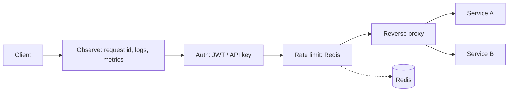

# API Gateway

A lightweight API gateway written in Go. It sits between clients and internal services, centralizing authentication, rate limiting, routing and observability.

[](https://github.com/VictorBontorin/API_Gateway/actions/workflows/ci.yml)

## Features

- **Authentication**: JWT (HS256, `exp` required) via `Authorization: Bearer <token>`, or static API keys via `X-API-Key`.
- **Rate limiting**: per user / API key (per IP for anonymous routes), backed by Redis with an atomic Lua script. Limits are configurable per route.
- **Routing**: prefix-based reverse proxy to upstream services, with optional prefix stripping.
- **Observability**: structured logs (`slog`, JSON in `prod`), request IDs (`X-Request-ID`) and Prometheus metrics at `/metrics`.
- **Config by environment**: environment variables + a JSON routes file.
- **Integration tests**: JWT, API key, header spoofing protection and rate limiting, using an in-memory Redis.

## Architecture



Each route is wrapped as `Observe -> Auth (optional) -> RateLimit -> Proxy`. The authenticated identity is forwarded to upstreams in the `X-User-ID` header; any `X-User-ID` sent by the client is discarded.

## Project layout

```
cmd/gateway/            entrypoint, graceful shutdown
internal/config/        env + routes loading
internal/auth/          JWT / API key middleware
internal/ratelimit/     Redis rate limiter
internal/observability/ logging, request id, Prometheus metrics
internal/gateway/       route wiring + reverse proxy (and integration tests)
```

## Running

With Docker (gateway + Redis + sample upstream):

```bash
docker compose up --build
```

Locally (needs Redis on `localhost:6379`):

```bash
export JWT_SECRET=change-me
export API_KEYS=mobile:abc123
go run ./cmd/gateway
```

Tests:

```bash
go test ./... -race
```

## Configuration

| Variable | Default | Description |
|---|---|---|
| `APP_ENV` | `dev` | `prod` switches logs to JSON |
| `GATEWAY_ADDR` | `:8080` | Listen address |
| `JWT_SECRET` | (required) | HS256 signing secret |
| `REDIS_ADDR` | `localhost:6379` | Redis address |
| `RATE_LIMIT_DEFAULT` | `60` | Requests per window when a route has no limit |
| `RATE_LIMIT_WINDOW` | `1m` | Rate limit window |
| `API_KEYS` | empty | `name:key,name2:key2` |
| `ROUTES_FILE` | `routes.json` | Path to the routes file |

Routes (`routes.json`):

```json
[
  { "prefix": "/whoami", "upstream": "http://whoami:80", "strip_prefix": true, "auth": true,  "rate_limit": 10 },
  { "prefix": "/public", "upstream": "http://whoami:80", "strip_prefix": true, "auth": false, "rate_limit": 30 }
]
```

## Examples

```bash
# 401: no credentials
curl -i http://localhost:8080/whoami/

# 200: API key
curl -i -H "X-API-Key: abc123" http://localhost:8080/whoami/

# 200: JWT (HS256, sub + exp claims)
curl -i -H "Authorization: Bearer <token>" http://localhost:8080/whoami/

# 429 after the limit is exceeded (see X-RateLimit-* and Retry-After headers)
for i in $(seq 1 35); do curl -s -o /dev/null -w "%{http_code} " http://localhost:8080/public/; done

# Prometheus metrics
curl http://localhost:8080/metrics
```

## Design notes and limitations

- Fixed-window rate limiting: simple and atomic, but allows bursts at window boundaries. A sliding window or token bucket would be more precise.
- Redis failures are fail-open (requests pass through and the error is logged), favoring availability over strictness.
- JWT: HS256 with a single shared secret. RS256/JWKS support is a natural next step.
- Routes are loaded at startup (no hot reload).
